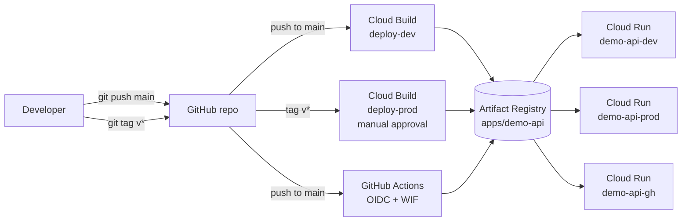

# demo-api: CI/CD Pipeline on Google Cloud (Cloud Build + Cloud Run)

A small Flask API deployed to Cloud Run through two independent CI/CD pipelines:

1. **Cloud Build** (native GCP): tests, builds, pushes and deploys to `dev` on every push to `main`, and to `prod` on a version tag after manual approval.
2. **GitHub Actions with Workload Identity Federation**: the same flow with **no service account keys** stored anywhere.

The app is intentionally simple. The point of this project is the delivery pipeline, the IAM design and the deployment strategy.

---

## Architecture



## Deployment strategy

| Event | Pipeline | Target service | Approval |
|---|---|---|---|
| Push to `main` | Cloud Build (`deploy-dev`) | `demo-api-dev` | None |
| Push to `main` | GitHub Actions (`deploy.yml`) | `demo-api-gh` | None |
| Push tag `v*` | Cloud Build (`deploy-prod`) | `demo-api-prod` | **Required** |

Every pipeline runs the same stages and stops at the first failure:

```
test (pytest) -> build (docker) -> push (Artifact Registry) -> deploy (Cloud Run)
```

Each image is tagged with the commit SHA, and the running version is exposed at `/` so a deployment can be traced back to a commit.

## Repository structure

```
demo-api/
├── .github/
│   └── workflows/
│       └── deploy.yml        # GitHub Actions pipeline (keyless auth)
├── tests/
│   └── test_app.py
├── .dockerignore
├── .gitignore
├── app.py                    # Flask app
├── cloudbuild.yaml           # Cloud Build pipeline
├── Dockerfile
├── pytest.ini
└── requirements.txt
```

## API endpoints

| Endpoint | Description |
|---|---|
| `GET /` | Returns message, environment (`APP_ENV`) and version (`APP_VERSION`) |
| `GET /health` | Health check |
| `GET /api/items` | Sample data |

## Security and IAM design

| Identity | Purpose | Roles |
|---|---|---|
| `cloudbuild-sa` | Runs Cloud Build pipelines | `run.admin`, `artifactregistry.writer`, `logging.logWriter`, and `iam.serviceAccountUser` on `run-app-sa` |
| `gh-deployer` | Used by GitHub Actions through WIF | `run.admin`, `artifactregistry.writer`, and `iam.serviceAccountUser` on `run-app-sa` |
| `run-app-sa` | Runtime identity of the Cloud Run services | **None** (the app calls no GCP APIs) |

Key decisions:

- **Separate pipeline and runtime identities.** If the running container is compromised, the attacker holds an identity with no permissions.
- **No default Compute Engine service account.** It often carries broad Editor access.
- **No long-lived keys.** GitHub Actions authenticates with short-lived OIDC tokens through Workload Identity Federation.
- **WIF is locked to this repository.** The provider has an attribute condition (`assertion.repository == '<owner>/demo-api'`), and only that repository's principal can impersonate `gh-deployer`.
- **Manual approval gate for production.** Approving builds requires `roles/cloudbuild.builds.approver`.

## Setup summary

> Full commands are in the build guide. This is the order of operations.

1. Create a GCP project, link billing and set a budget alert.
2. Enable APIs: Cloud Run, Cloud Build, Artifact Registry, IAM, IAM Credentials, Secret Manager.
3. Create the Artifact Registry Docker repository `apps` in `us-central1`.
4. Create the service accounts and role bindings above.
5. Connect GitHub to Cloud Build (2nd gen connection, region `us-central1`) and link this repository.
6. Create the `deploy-dev` trigger (branch `^main$`) and the `deploy-prod` trigger (tag `^v.*$`, approval required).
7. Create the Workload Identity Pool and provider, and bind `gh-deployer` to this repository.
8. Add the GitHub repository secrets `WIF_PROVIDER` and `WIF_SERVICE_ACCOUNT`.

Tip: the commands use shell variables (`$PROJECT_ID`, `$REGION`, `$GH_USER`, ...). Set them in every new terminal session.

## Run locally

```bash
python -m venv .venv && source .venv/bin/activate
pip install -r requirements.txt pytest
pytest -q

docker build -t demo-api:local .
docker run --rm -p 8080:8080 -e PORT=8080 demo-api:local
curl localhost:8080/health
```

## How to verify it works

```bash
# Dev (Cloud Build): version should equal the latest commit SHA
curl $(gcloud run services describe demo-api-dev --region=us-central1 --format='value(status.url)')

# Prod (after approval): env should be "prod"
curl $(gcloud run services describe demo-api-prod --region=us-central1 --format='value(status.url)')

# GitHub Actions service: the image tag is the full commit SHA
gcloud run services describe demo-api-gh --region=us-central1 \
  --format='value(spec.template.spec.containers[0].image)'

# All services
gcloud run services list --region=us-central1
```

### Screenshots

| | |
|---|---|
| Green Cloud Build run | `docs/cloudbuild-success.png` |
| Prod approval screen | `docs/prod-approval.png` |
| Failed test stops the pipeline before deploy | `docs/failed-test.png` |
| Green GitHub Actions run (no key file in auth step) | `docs/github-actions-success.png` |
| `gcloud run services list` output | `docs/services-list.png` |

## Guardrail test

To prove the pipeline blocks bad code, I changed a test assertion so it failed and pushed to `main`. The `test` step failed, the build, push and deploy steps never ran, and the running revision was unchanged. I then reverted the commit, which restored a green build.

## Troubleshooting notes (problems I hit and fixed)

| Problem | Cause | Fix |
|---|---|---|
| `ModuleNotFoundError: No module named 'app'` in pytest | The project root was not on `sys.path` | Added `pytest.ini` with `pythonpath = .` |
| `gcloud` errors such as "REPOSITORY must be specified" or "SERVICE_ACCOUNT: Must be specified" | Shell variables were empty after a new terminal session | Re-exported variables and persisted them in `~/.bashrc` |
| Trigger existed but no build ran | Build had never been fired, or the history was filtered to the wrong region | Ran the trigger manually, then confirmed push events fire it |
| `tag 'v1.0.0' already exists` | Tag had been created earlier | Checked `git ls-remote --tags origin`, then reused or re-created the tag |
| WIF failures | Placeholder values (`YOUR_USER`, `YOUR_PROJECT_ID`) pasted literally | Replaced with real values and searched with `grep -rn "YOUR_" .` |
| `PERMISSION_DENIED` on Artifact Registry push and Cloud Run deploy from GitHub Actions | IAM bindings were created while variables were empty, plus IAM propagation delay | Re-granted roles with explicit values, waited a few minutes, re-ran the workflow |

Lessons learned:

- Placeholders (`YOUR_USER`) are not shell variables. Nothing fills them in.
- IAM changes can take a few minutes to take effect.
- Cloud Shell sessions reset environment variables, so scripts and docs should not rely on them.
- Secrets are masked in GitHub logs, which makes identity problems harder to debug.

## Cost

Everything used here sits in or near the free tier: Cloud Run scales to zero, Cloud Build includes free build minutes, and Artifact Registry has a small free storage allowance. A billing budget alert is configured on the project.

## Cleanup

```bash
gcloud run services delete demo-api-dev  --region=us-central1 -q
gcloud run services delete demo-api-prod --region=us-central1 -q
gcloud run services delete demo-api-gh   --region=us-central1 -q
gcloud artifacts repositories delete apps --location=us-central1 -q
```

Or delete the whole project with `gcloud projects delete <PROJECT_ID>`.

## What I would improve

- **Promote the same image to prod** instead of rebuilding on the tag, so what was tested is exactly what ships.
- **Separate GCP projects per environment** (dev, prod) for stronger isolation of IAM and billing.
- **Vulnerability scanning** (Artifact Registry scanning or Trivy) and secret scanning (gitleaks) in the pipeline.
- **Rollback automation** with `gcloud run services update-traffic`, plus gradual traffic splitting for canary releases.
- **Infrastructure as Code**: provision all of this with Terraform instead of console clicks and CLI commands.
- **Remove public access** (`--allow-unauthenticated`) behind a load balancer or IAP for non-demo workloads.
- **Pin and update action versions** (`actions/checkout`, `google-github-actions/auth`, ...) and pin the runner image.
- **Add monitoring**: dashboards, log-based metrics and SLO alerts.

## Tech stack

Python 3.12, Flask, Gunicorn, Docker, Cloud Build, Artifact Registry, Cloud Run, GitHub Actions, Workload Identity Federation, IAM.
